# PYQ Hub

Previous year question papers for NITK, in one place. Students find papers by branch,
year and course, preview and download them, and upload the ones that are missing.
Admins check every upload before it goes live.

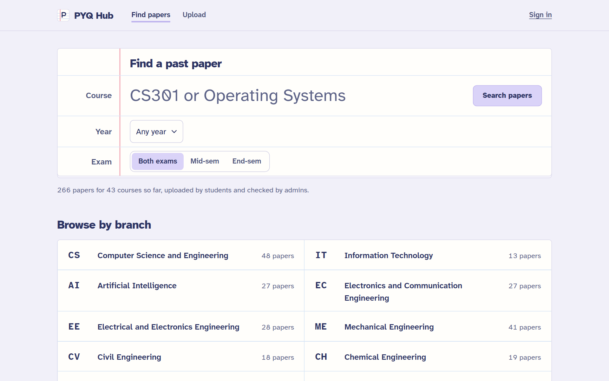

- [Using PYQ Hub (students)](#using-pyq-hub-students)
- [Running PYQ Hub (admins)](#running-pyq-hub-admins)
- [Running it on your computer](#running-it-on-your-computer)
- [Deploying the server](#deploying-the-server)
- [Configuration](#configuration)

---

## Using PYQ Hub (students)

You don't need an account to find, preview or download papers. You only need one to upload.

### Find a paper

Type a course code or name in the **Course** line on the home page. Matching courses
appear as you type; press <kbd>Enter</kbd> or pick one to open it. `CS301`, `cs 301`
and `CS-301` all work. To search across courses instead, press **Search papers**, and
narrow it down by exam year or mid-sem / end-sem if you like.

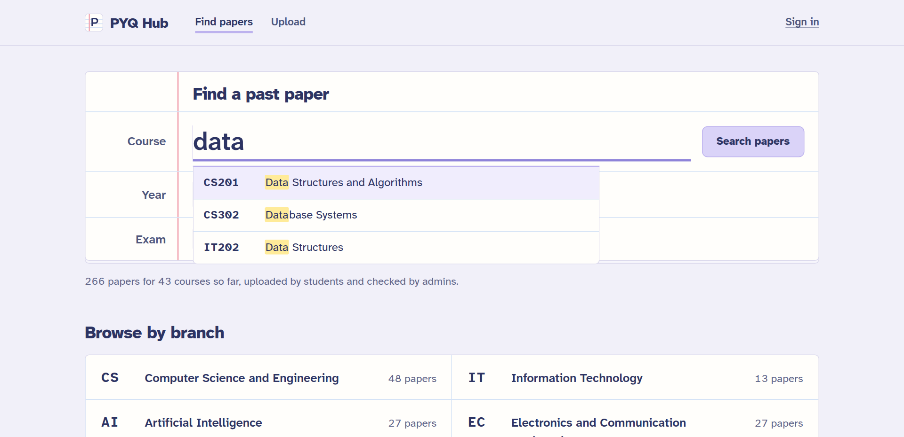

You can also browse: pick your branch on the home page, then your year of study.
First-year courses are shared by every branch and appear under 1st year in each one.

### Read a course page

Each course has a grid of years and exams. Every cell tells you where that paper stands:

| Cell | Meaning |
|---|---|
| Mint download icon, "Download" | The paper is up. Select the cell to download it. |
| Peach, "Waiting for review" | Someone has uploaded it and an admin is checking it. No need to upload it again. |
| Dashed box, "Not uploaded yet" | Nobody has it yet. Select **+ Upload it** if you do. |

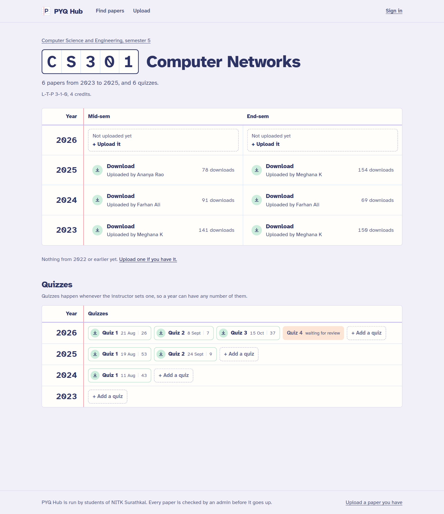

### Search results

Search results show each matching course with its last five years. Each year has an
**M** (mid-sem) and an **E** (end-sem) square. A filled mint square opens the paper; a
dashed square means it's missing and takes you to the upload form.

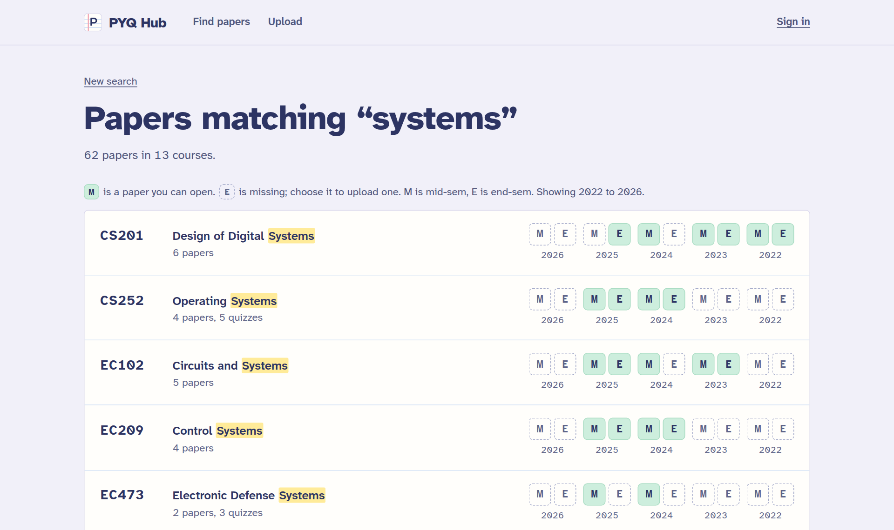

Opening a paper shows it in the page, with **Download PDF** and **Open in new tab**.
If the preview doesn't show on your phone, use Download PDF.

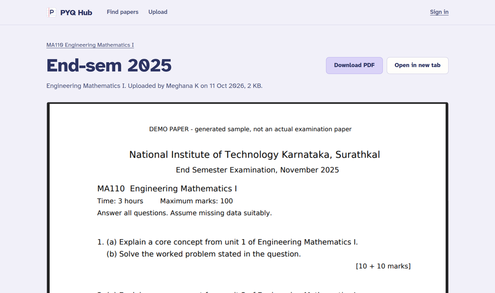

### Create an account

Select **Sign in**, then **Create an account**. Use your college email (it must end in
`@nitk.edu.in`). We email you a link; open it to confirm your address. You can browse
straight away, but uploading needs a confirmed email.

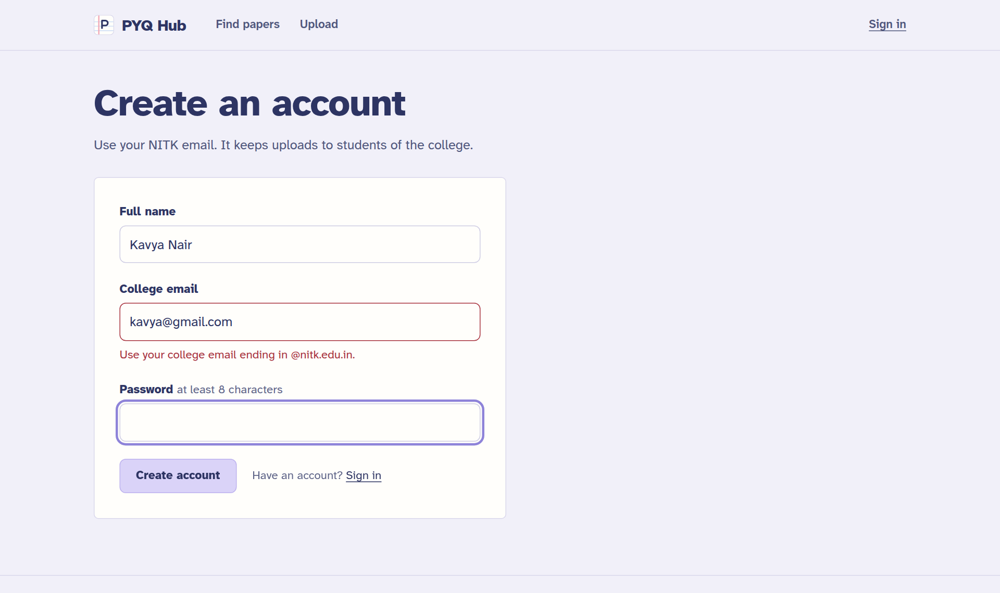

### Upload a paper

1. Select **Upload**, or select a dashed "Not uploaded yet" cell, which fills in the
   course, year and exam for you.
2. Check the course, exam year and mid-sem / end-sem.
3. Attach the question paper as **one PDF** with every page, up to 20 MB.
4. Add a note if something is unusual ("makeup exam", "page 4 is faint").
5. Select **Submit for review**.

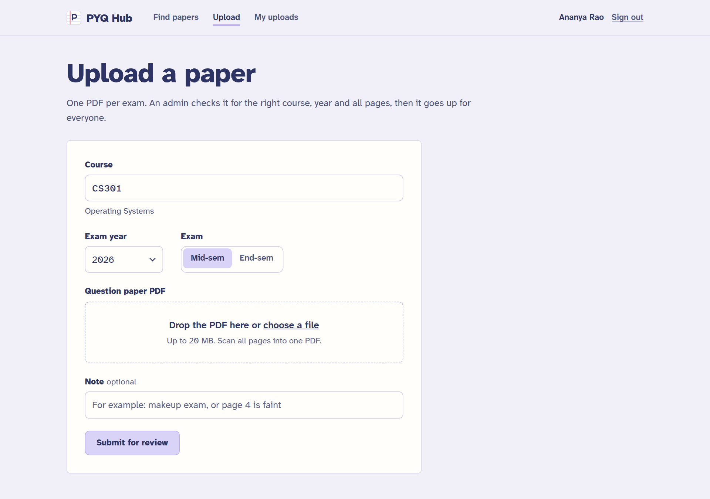

An admin checks that it's the right course, year and complete. Track it under
**My uploads**:

| Stamp | Meaning |
|---|---|
| Pending review | Waiting for an admin. |
| Approved | Live for everyone. |
| Rejected | Not published. The reason is shown underneath; fix it and upload again. |
| Replaced | An admin swapped it for a better copy of the same paper. |

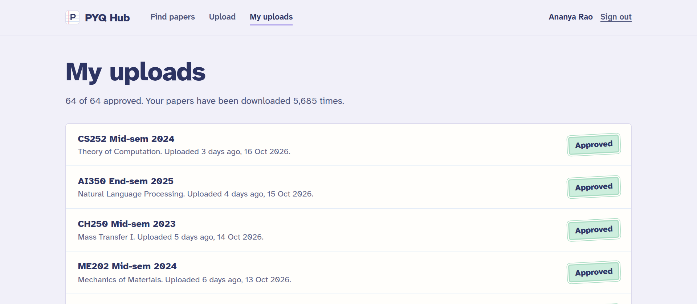

If an identical file is already on the site, the upload is refused straight away so the
archive doesn't fill with copies.

---

## Running PYQ Hub (admins)

### Your account

The first admin account is created when the server starts for the first time, from
`ADMIN_EMAIL`, `ADMIN_NAME` and `ADMIN_PASSWORD` (see [Configuration](#configuration)).
Set a strong password **before** the first start; the app has no password-change screen yet.

To make someone else an admin, ask them to sign up, then change their role to **Admin**
under **Admin → People**.

Sign in and select **Admin** in the top bar. The number next to it is how many uploads
are waiting for you.

### Overview

Totals at the top (approved papers, uploads waiting, downloads, accounts, contributors),
downloads per day for the last 30 days, the most downloaded papers, what students search
for, papers per branch, and **courses with no papers**: the list to send round when
asking seniors for papers.

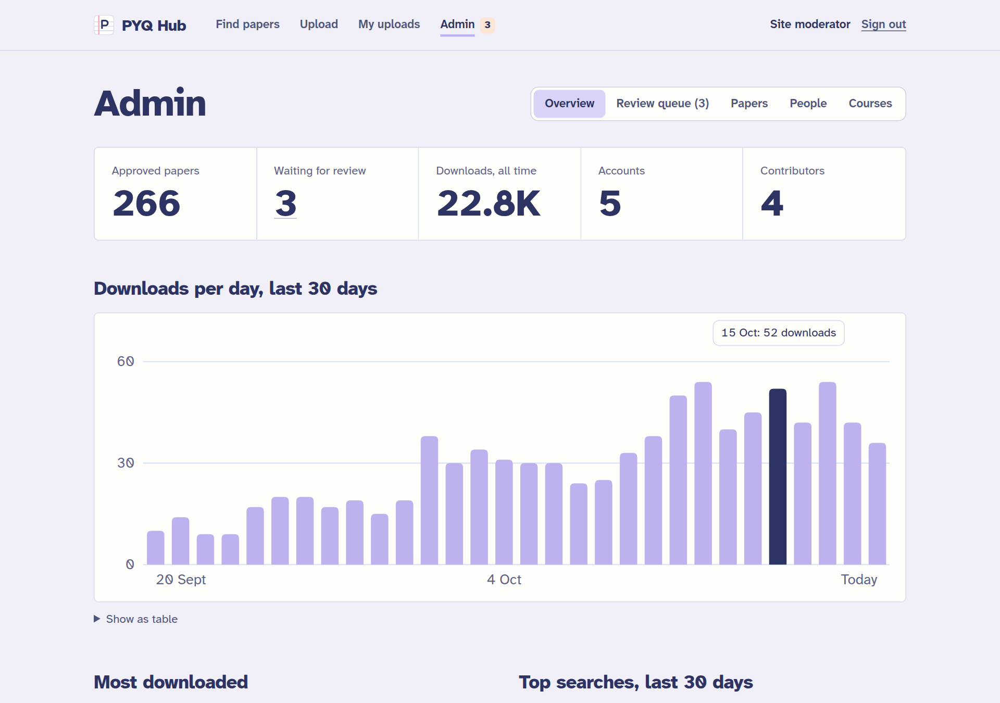

### Review queue

Uploads appear oldest first, with the PDF on the left. For each one, check the course,
year and exam match the paper, and that every page is there and readable.

- **Approve** publishes it.
- **Approve and replace old copy** appears when the same course, year and exam already
  has an approved paper. Use it when the new scan is better; the old one is marked Replaced.
- **Reject** asks for a reason. The quick reasons (pages missing, unreadable, wrong
  course or year, not a question paper) fill it in. The student sees the reason under My uploads.

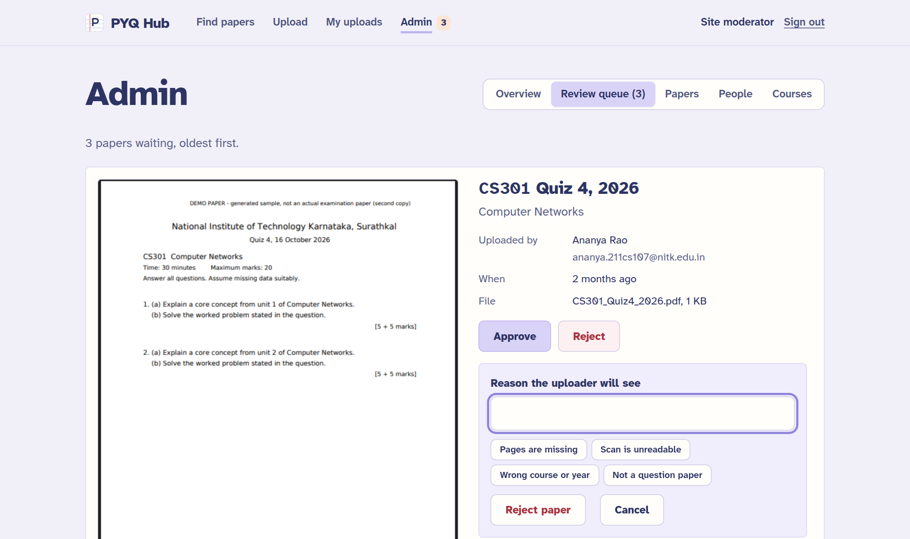

### Papers

Every approved, rejected and replaced paper, filterable by course code. **Delete**
removes the paper and its PDF permanently; use it for anything that shouldn't be on the
site at all.

### People

Everyone with an account: what they've uploaded, when they joined, and their role.
Change a role with the dropdown. **Suspend** (it asks you to confirm) stops someone
signing in or uploading; **Restore** undoes it. Their approved papers stay up.

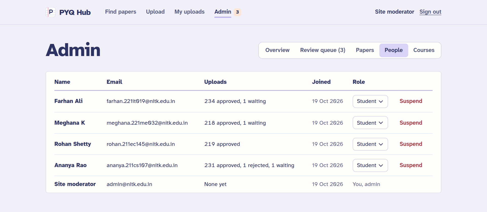

### Courses

Students can only upload papers for courses that exist. Add new courses and electives
here with their code, name, branch (or "Common to all" for first-year courses) and year
of study.

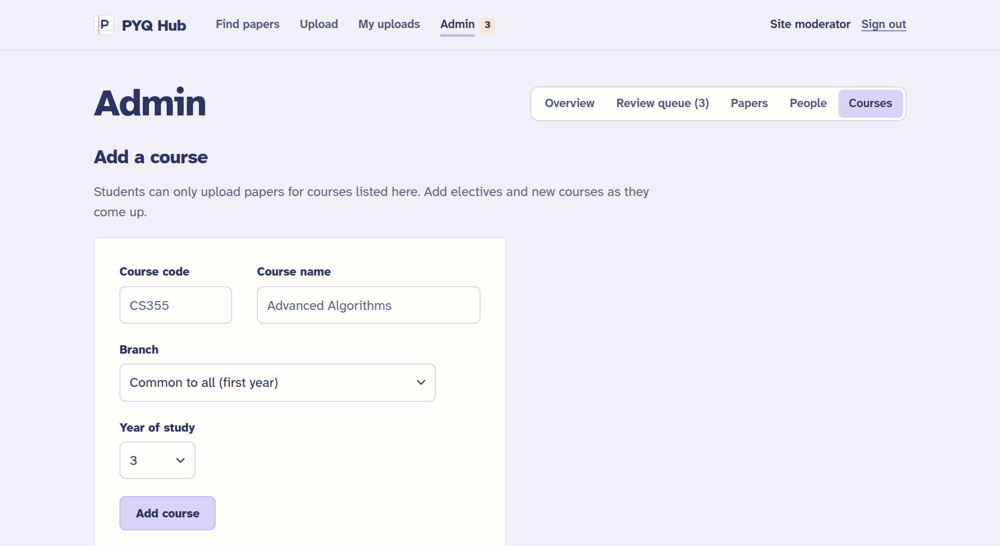

---

## Running it on your computer

Needs **Node.js 22.13 or newer**. The database is Node's built-in SQLite, so there is
nothing else to install.

```sh
npm install
npm run seed:demo   # optional: demo students, ~250 sample papers, 30 days of activity
npm start           # http://localhost:3000
```

- Admin: `admin@nitk.edu.in` / `admin12345`
- Demo student: `ananya.211cs107@nitk.edu.in` / `student123`

Use `npm run dev` to restart automatically when server files change. Without SMTP
settings, verification links are printed in the terminal and shown on screen.

<p>
  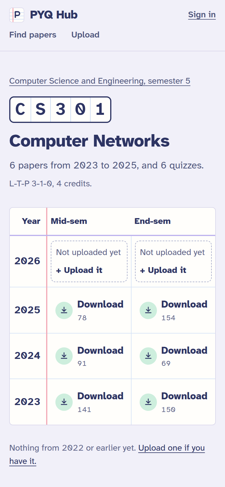
  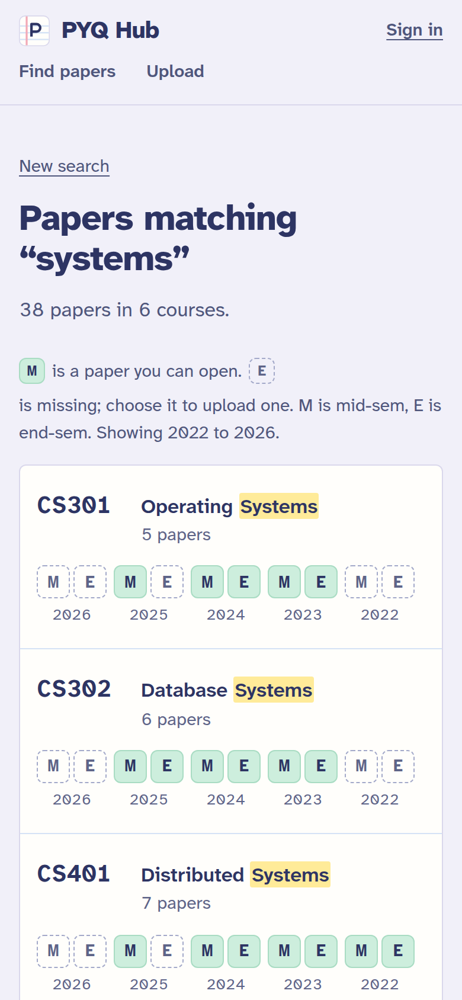
</p>

